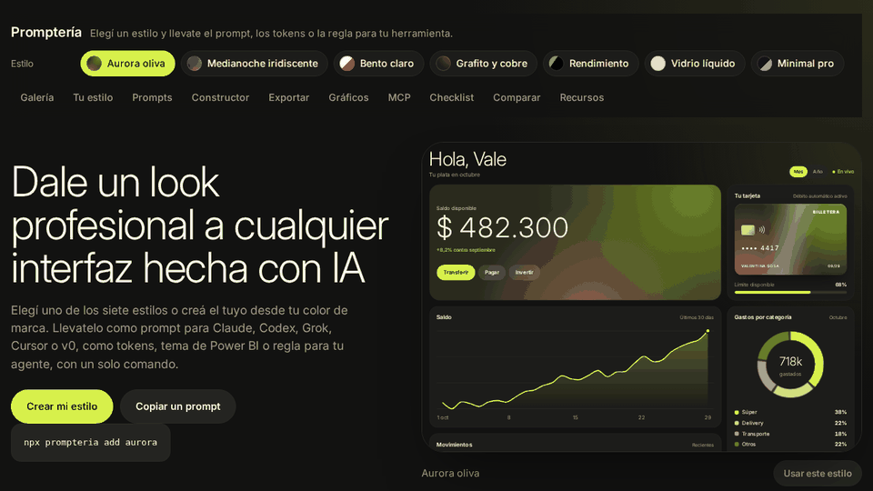

# Promptería

### Los datos son los mismos. La forma de mostrarlos cambia todo.

Elegí un estilo, creá uno con el color de tu marca y llevá esa identidad a tus dashboards, tus herramientas de IA y tus reportes de **Power BI**.

**[Probá la demo →](https://cardo991.github.io/prompteria/)** · [Temas de Power BI](https://cardo991.github.io/prompteria/#powerbi) · [Recetario de gráficos](https://cardo991.github.io/prompteria/#graficos)



## De una idea a una identidad visual

Un dashboard necesita más que gráficos: necesita jerarquía, contraste y una paleta que tenga sentido. Promptería reúne estilos y herramientas para llevar esa intención al resultado.

- **7 estilos visuales** para explorar sobre 6 dashboards de ejemplo.
- **Tu propia marca:** generá una paleta desde un color, en modo claro u oscuro, con comprobaciones de contraste para el texto.
- **Prompts por herramienta:** Claude, Codex, Grok, Cursor y v0 / Lovable.
- **Constructor de prompts:** combiná tipo de dashboard, estilo, stack y herramienta.
- **14 recetas de gráficos:** ejemplo visual, cuándo usarlo y un prompt para copiar.
- **Exportaciones:** CSS, Tailwind, design tokens, temas de Power BI y reglas para agentes.
- **CLI y servidor MCP** para trabajar desde tu proyecto.

## Power BI tiene su lugar

Llevá el estilo de tu marca a un reporte con un **tema JSON para Power BI Desktop**.

1. Entrá a la [sección Power BI](https://cardo991.github.io/prompteria/#powerbi).
2. Elegí un estilo. Si creás el tuyo, tocá **Probar en la página** para activarlo.
3. Descargá el tema `.json`.
4. En Power BI Desktop: **Vista → Temas → Examinar temas** e importá el archivo.

El tema incluye colores de series, estados positivos y negativos, fondos, tipografías y formato base de visuales. La estructura, los datos y las medidas se definen en Power BI. Los visuales con formato manual pueden necesitar restablecer su formato para heredar el tema.

La galería web muestra referencias visuales; el resultado en Power BI depende de los visuales utilizados. La importación final debe verificarse en Power BI Desktop.

## Un gráfico para cada pregunta

Área · Barras · Dona · Velas · Anillos · Embudo · Mapa de calor · Gauge · Barras horizontales · Apiladas al 100% · Dispersión · Cascada · Pareto · Resultado contra meta.

Cada receta combina una vista previa que sigue el estilo activo, una explicación de uso y un prompt con criterios de diseño.

## Usalo en tu máquina

La web es estática: podés abrir `index.html` directamente, sin instalar dependencias.

Para usar las herramientas del proyecto:

```bash
git clone https://github.com/cardo991/prompteria.git
cd prompteria
npm ci
node bin/prompteria.mjs list
node bin/prompteria.mjs add aurora
node bin/prompteria.mjs create --name "Mi marca" --primary "#0F766E"
```

La CLI puede preparar archivos para Claude Code, Cursor y Codex, además de exportar tokens. Consultá las opciones con `node bin/prompteria.mjs --help`.

## Conectalo a tu agente con MCP

Con el repositorio clonado y las dependencias instaladas, ejecutá:

```bash
node mcp/server.mjs
```

Configurá tu cliente MCP para ejecutar `node` con la ruta absoluta a `mcp/server.mjs` como argumento. El servidor permite consultar estilos, crear paletas, construir prompts y obtener exportaciones.

## Desarrollo

```bash
npm run build   # Genera estilos y exportaciones
npm test        # Ejecuta las comprobaciones del proyecto
```

Los estilos se definen en `styles/`; la interfaz y los generadores viven en `src/`. ¿Querés sumar un estilo? Mirá [cómo contribuir](CONTRIBUTING.md).

## Hecho para compartir

Probá una paleta, adaptala a tu marca y usala en tu próximo proyecto. Si te sirve, una estrella ayuda a que otras personas lo encuentren.

Creado por [Lucas Cardozo](https://github.com/cardo991). Licencia [MIT](LICENSE).
